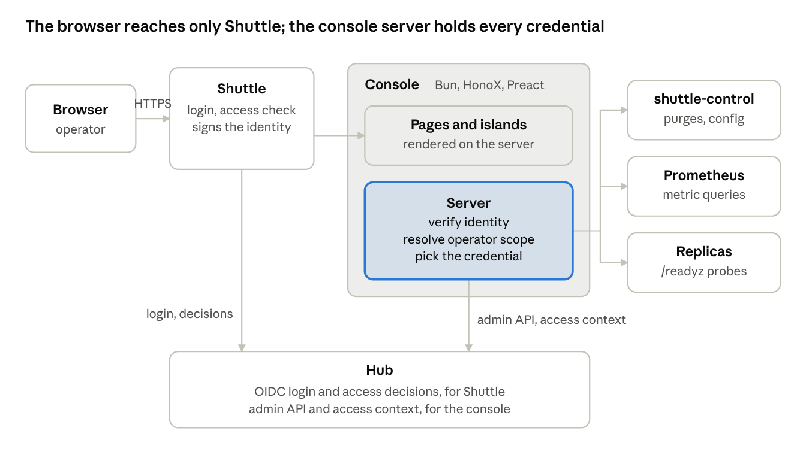
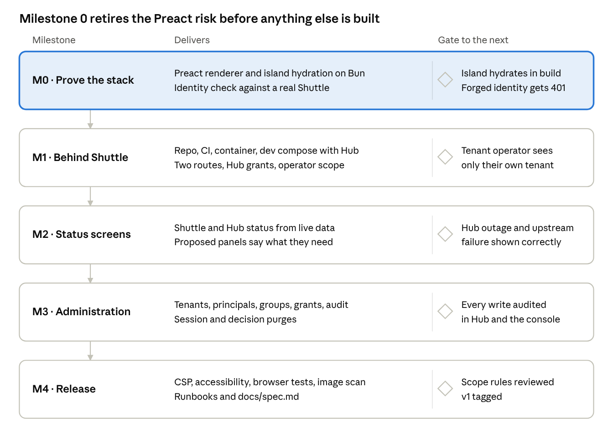

# Gantry Build Plan

Oct 23, 2026 · Isaac

## Goal and scope

Build **Gantry**: one web app, in its own repo, that shows the live status of Shuttle and Hub and lets operators run Hub's admin tasks. It runs as an ordinary upstream behind Shuttle, so Shuttle handles login (through Hub) and the access check, and Gantry never sees a password or holds a session of its own.

**Users:** platform operators (every tenant) and tenant operators (one tenant). On-call engineers get read-only status.

**v1 includes**

- The Shuttle status screen and the Hub status screen from the mockup, wired to real data.
- Hub administration: tenants, principals, groups, grants, and the audit log, through Hub's `/v1/admin/*` API.
- Shuttle operations through `shuttle-control`: purge a subject's sessions, purge cached access decisions.
- Read-only view of Shuttle's route table and replica revisions.
- Route table history, validation with a diff against the active table, and one-click rollback to an earlier revision, through `shuttle-control` (Shuttle 1.3.0).

**v1 excludes**

- Writing a new route table from the UI. `shuttle-control` supports it since Shuttle 1.3.0, but route changes stay pull requests in v1 so they keep review and history. Revisit after v1.
- Any secret or environment setting of Shuttle or Hub.
- A public status page. That is a separate, coarse page hosted outside Shuttle and Hub.
- Hub's deferred features (SAML, SCIM, directory sync, account linking).

## Stack

HonoX renders every page on the server and ships JavaScript only for islands, and Preact keeps those islands small. HonoX does not ship a Preact renderer: its README lists Preact under "Bring your own renderer" with the note "We may not provide support for the renderer you bring." Milestone 0 proves the integration before anything else is built.

| Piece | Version to pin | Role |
| --- | --- | --- |
| Bun | 1.4.4 (Shuttle and Hub require ≥ 1.4.3) | Runtime, package manager, test runner |
| Hono | 4.13.13 (the version Shuttle and Hub pin) | HTTP layer, middleware, `hono/bun` static serving |
| HonoX | 0.1.62 | File-based routes, islands, the Vite plugin |
| Vite | 8.x | Dev server and build, run with `bunx --bun vite` |
| `@hono/vite-dev-server/bun`, `@hono/vite-build/bun` | 0.26.1, 1.11.1 | Bun adapter for dev; Bun output (`dist/index.js`) for production |
| Preact | 10.29.8 to start | Islands and server-rendered pages |
| `preact-render-to-string` | 6.x | Server rendering of Preact trees |
| `@preact/preset-vite` | 2.10.x | JSX transform and fast refresh for islands |
| `jose` | 6.2.12 (as in Shuttle and Hub) | Verifying Shuttle's identity signature |
| `zod` | 4.6.7 (as in Shuttle and Hub) | Validating every API response and form body |
| Biome, knip, TypeScript 5.9 | as in Shuttle and Hub | Lint, format, dead-code and type checks |
| Impeccable | 4.7.0, from M1 | Design skill for the coding agent, and `impeccable detect` design checks in CI. Dev only, never in the image |

Preact 11.0.1 shipped on 8 Oct 2026. Start on Preact 10, then move to 11 in its own change once the Milestone 0 tests pass on it.

**How the pieces connect**

1. `tsconfig.json`: `"jsx": "react-jsx"`, `"jsxImportSource": "preact"`, so routes and islands are Preact components.
2. `vite.config.ts`: `honox({ devServer: { adapter }, islandComponents: { reactApiImportSource: 'preact/compat' }, client: { input: ['/app/client.ts', '/app/style.css'] } })`, plus `build()` from `@hono/vite-build/bun` and `preact()` for the client. HonoX's island wrapper imports `createContext`, `useContext` and `isValidElement` from the configured source. Plain `preact` has no `useContext` (it lives in `preact/hooks`), so the wrapper must point at `preact/compat`.
3. `app/routes/_renderer.tsx`: a small middleware that calls `c.setRenderer` and returns `c.html('<!doctype html>' + renderToString(<Layout {...props}>{content}</Layout>))`. This replaces `@hono/react-renderer`, which has no Preact equivalent on npm.
4. `app/client.ts`: `createClient({ hydrate: async (el, root) => (await import('preact')).hydrate(el, root), createElement: async (type, props) => (await import('preact')).h(type, props) })`.
5. Build with `vite build --mode client && vite build`, then run `bun index.js` from inside `dist/`. Read configuration with `env(c)` from `hono/adapter`, not `process.env`, which Vite replaces with an empty object at build time.

Sources: [HonoX README](https://github.com/honojs/honox) ("BYOR" and "On-Premises or Other Platforms"), the HonoX island wrapper in `src/vite/components/honox-island.tsx`, and npm package metadata, checked on the date above.

## Architecture

The gantry is a backend-for-frontend: the browser talks only to Shuttle, Shuttle forwards to the gantry, and the gantry's server makes every call to Hub, `shuttle-control`, Prometheus and the replicas.



Shuttle logs the operator in through Hub and asks Hub whether they may use the gantry route; only then does the request reach the gantry. A page load renders on the server from parallel upstream calls. Islands then refresh through same-origin `/api/*` endpoints every 15 seconds, so no credential or upstream address ever reaches the browser.

## Repository layout

One repo, `gantry`, laid out like Shuttle and Hub: a normative `docs/spec.md`, a decision log, and checks that the build enforces. Server code never ships to the browser; only `app/islands/` and `app/client.ts` do.

```
gantry/
  app/
    routes/
      _renderer.tsx          Preact renderer (c.setRenderer + renderToString)
      _middleware.ts         identity check, operator scope, CSRF, secure headers
      _error.tsx, _404.tsx
      index.tsx              redirects to /shuttle
      shuttle/index.tsx      Shuttle status
      shuttle/routes.tsx     route table and replica revisions, read-only
      hub/index.tsx          Hub status
      hub/tenants/[slug].tsx one tenant: principals, groups, grants
      hub/audit.tsx          audit log, filters, CSV export
      api/                   same-origin JSON endpoints the islands poll or post to
    islands/                 Preact islands: request funnel, route table, tenant table,
                             trend chart, grant form, purge dialog, live refresh
    components/              server-only Preact parts: tiles, status chips, layout
    server/
      identity.ts            copy of Shuttle's examples/upstream-identity/verify.ts
      operator.ts            caller -> tenant -> permission keys -> scope
      clients/hub-admin.ts   /v1/admin/* and /v1/access-context
      clients/shuttle-control.ts
      clients/prometheus.ts  PromQL queries behind every chart and tile
      clients/probes.ts      /readyz of each Shuttle and Hub replica
      schemas/               zod schema for every upstream response
      audit.ts               one log line per gantry action
      env.ts                 reads and validates the environment once
    client.ts                createClient with Preact hydrate
    style.css
  test/
    unit/ contract/ browser/ fixtures/
  deploy/
    Dockerfile compose.yaml kubernetes/ shuttle-route.json hub-grants.json
  docs/
    spec.md decisions.md operations.md
  .impeccable/config.json    design tooling settings, telemetry off (from M1)
  PRODUCT.md                 product context written by /impeccable init (M1)
  DESIGN.md                  design system written by /impeccable document (end of M1)
  compatibility.json         pinned Shuttle and Hub revisions
  vite.config.ts tsconfig.json biome.json knip.json package.json
```

The gantry keeps no database in v1. Everything it shows is read live from Hub, `shuttle-control`, Prometheus and the replicas' `/readyz`.

## Security model

Shuttle and Hub decide who reaches the gantry; the gantry decides what each person may do inside it, and it never trusts a header it has not verified. Every request passes four checks in order.

1. **Shuttle gate.** Two routes on the gantry host. `gantry` matches `GET` and requires a Hub grant on route `gantry`; `gantry-admin` matches `POST`, `PUT` and `DELETE` and requires a grant on route `gantry-admin`. Both use `auth.mode: session`, `accessCheck: true`, `crossSite: strict` and `forwardAuthorization: false`. So Hub decides, per request, whether someone may view or change anything.
2. **Identity.** `_middleware.ts` verifies `x-shuttle-signature` with the deployment's public key, using a pinned copy of Shuttle's reference verifier (currently signature `v5`, ES256). A request without a valid signature gets `401`, so a request that skipped Shuttle cannot act as anyone.
3. **Operator scope.** The gantry looks up the caller's principal (`GET /v1/admin/users?email=` and match on `x-shuttle-user`) to learn their tenant. It then asks `POST /v1/access-context` for their permission keys on route `gantry`. `gantry.platform` means platform operator; anything else is scoped to that tenant. The result is cached no longer than the `validUntil` Hub returns (at most 5 s).
4. **Credential choice.** The backend picks a Hub admin credential matching the scope: the platform credential only for `gantry.platform`, otherwise that tenant's credential from `GANTRY_HUB_ADMIN_TOKENS`. No matching credential means `403`. Hub then enforces the tenant boundary again on its side.

**Other rules**

- Credentials (Hub admin tokens, the access-context token, the `shuttle-control` tokens, the Prometheus token) live only in the server environment, read through `*_FILE` variables. They never reach the browser, a log line or an error page.
- Islands call only same-origin `/api/*` endpoints; they never call Hub or `shuttle-control` directly.
- Writes need `POST`/`PUT`/`DELETE`, pass Hono's `csrf()` origin check, and carry a confirmation step for destructive actions (revoke, purge).
- `secureHeaders()` with a strict Content-Security-Policy and a per-request nonce on HonoX's `<Script>`.
- Every write logs one JSON line: request id, operator email, principal id, tenant, action, target, Hub's or `shuttle-control`'s answer. The gantry passes the operator's email as `grantedBy` so Hub's own audit names the person, not just the gantry's credential. `shuttle-control`'s audit names only the operator of the token, which is always the gantry, so the gantry's own line is the only record of which person purged or rolled back.
- `shuttle-control` scopes do not nest: `operate` cannot write the route table and `config` cannot purge. The gantry holds one token of each and uses the `config` token only for rollback, only for `gantry.platform` operators.
- Roles in `x-shuttle-roles` are display-only. Hub's spec calls them "context, not policy" because they are a snapshot from login.

## Milestones

Five milestones, each ending in a gate that must pass before the next starts. Read-only status ships before any write, so the riskiest code (admin actions) is built on a proven identity and scope layer.



M0 is a throwaway spike in a branch: one route, one island, the renderer, and the identity check in a dev compose with real Shuttle and Hub. If the island will not hydrate with Preact, take the fallback in Risks before M1 starts. M2 can run in parallel with the Shuttle and Hub metric changes listed under Dependencies. M3 builds the purges, history, validation and rollback against the real `shuttle-control` from the pinned Shuttle release, not a stand-in.

**Design tooling by milestone**

[Impeccable](https://github.com/pbakaus/impeccable) joins at the start of M1, not in M0: the spike has no UI worth designing, and `init` asks questions that a person, not the agent, must answer.

| When | Command | Purpose |
| --- | --- | --- |
| Start of M1 | `npx impeccable install --providers=claude --scope=project`, then `/impeccable init` (answered by a person) | Record the product context in `PRODUCT.md`: operators and on-call users, dense data, calm screens, color reserved for status, readable during an outage |
| End of M1 | `/impeccable document` | Write `DESIGN.md` from the real layout and components |
| Before each M2 screen | `/impeccable shape` | Plan the Shuttle and Hub status screens, starting from the mockups |
| After each M2 screen | `/impeccable critique`, `/impeccable audit` | Review hierarchy and clarity, accessibility, and layout at 390 px |
| M3 | `/impeccable harden`, `/impeccable clarify` | Error states, long names, and the wording of revoke and purge confirmations |
| M4 | `/impeccable polish` | Final pass before tagging v1 |

Not used: `bolder`, `colorize`, `delight`, `animate`, `overdrive`. An ops gantry stays quiet, and color here means status.

Impeccable sends usage telemetry by default. Commit `.impeccable/config.json` with `"telemetry": false` so it is off for everyone, and keep `.impeccable/config.local.json` gitignored.

## Testing and CI

The suite proves two things: the gantry never acts without a verified identity and the right scope, and it keeps working against the exact Shuttle and Hub revisions it pins.

| Kind | Where | What it proves | Tool |
| --- | --- | --- | --- |
| Unit | `app/**/*.test.ts` | Identity verification, scope resolution, credential choice, every zod schema, PromQL builders | `bun test` |
| Contract | `test/contract/` | Each route and `/api/*` endpoint against fake Hub, `shuttle-control` and Prometheus servers: `401` without a signature, `403` without scope, a tenant operator never sees another tenant, writes log one audit line | `bun test` |
| Compatibility | `test/compatibility/` | The gantry against the real Hub, the real Shuttle and the real `shuttle-control` at the revisions in `compatibility.json` (currently Shuttle v1.3.0 and Hub v1.0.1, the pair Hub tests together), with Hub's embedded Postgres, the same way Hub tests itself against Shuttle | `bun test` |
| Browser | `test/browser/` | Islands hydrate, refresh, and submit; CSP has no violations; pages work at 390 px wide and by keyboard | Playwright 1.64 (the version Shuttle uses) |
| Static | | Types, lint, format, dead code, no server import in `app/islands/` | `tsc`, Biome, knip, a small import-boundary script |
| Design | `app/` | Impeccable's 62 rule-based design checks, no AI involved. Advisory from M2, blocking once the backlog is clear | `npx impeccable detect --github app/` |

CI runs on every pull request: `bun install --frozen-lockfile`, the static checks, unit and contract tests, the client and server builds, then the compatibility and browser suites. A release tag builds and scans the container image, attaches an SBOM, and fails above "high", matching Hub's image policy.

## Deployment

The gantry ships as one container that runs `bun index.js` from the built `dist/`, deployed next to Shuttle and Hub and reachable only from Shuttle.

**Container**

- Multi-stage `Dockerfile`: build with `oven/bun` (`bun install --frozen-lockfile`, both Vite builds), copy only `dist/` into the final stage.
- Non-root user, no shell, base image pinned by digest, like Hub's image.
- `GET /healthz` (process alive) and `GET /readyz` (config loaded and the Shuttle public key parsed). Readiness does not depend on Hub, so a Hub outage does not pull the gantry out of rotation.

**Shuttle route table** (`deploy/shuttle-route.json`, merged into the deployment's routes by pull request)

```jsonc
{ "id": "gantry", "match": { "host": "admin.example.com", "path": "/", "methods": ["GET"] },
  "upstream": "http://gantry:3000", "auth": { "mode": "session" }, "accessCheck": true,
  "accessStaleGraceMs": 300000, "crossSite": "strict", "forwardAuthorization": false },
{ "id": "gantry-admin", "match": { "host": "admin.example.com", "path": "/", "methods": ["POST", "PUT", "DELETE"] },
  "upstream": "http://gantry:3000", "auth": { "mode": "session" }, "accessCheck": true,
  "crossSite": "strict", "forwardAuthorization": false }
```

The view route gets a 5-minute grace so on-call keeps seeing status during a Hub outage; the admin route gets none. Add both ids to `SHUTTLE_PROTECTED_ROUTES` on `shuttle-control`, so no route-table write or rollback can remove or change them.

**`shuttle-control`** listens on `SHUTTLE_CONTROL_PORT` (default `9090`) and binds the loopback address by default. The deployment sets `SHUTTLE_CONTROL_HOST` so the gantry can reach it on the internal network, and nothing outside that network can.

**Hub grants** (`deploy/hub-grants.json`, applied with the batch form of `PUT /v1/admin/grants`)

| Permission | Route | Given to |
| --- | --- | --- |
| `gantry.status` | `gantry` | on-call group |
| `gantry.admin` | `gantry` and `gantry-admin` | tenant operators, in their tenant |
| `gantry.platform` | `gantry` and `gantry-admin` | platform operators group |

**Environment**

| Variable | Holds |
| --- | --- |
| `GANTRY_PORT` | Listener port, default `3000` |
| `GANTRY_SHUTTLE_IDENTITY_PUBLIC_KEY_FILE` | Shuttle's identity public key (P-256) |
| `GANTRY_HUB_URL` | Hub's internal address |
| `GANTRY_HUB_ADMIN_TOKENS_FILE` | JSON map of tenant slug (or `*` for platform) to Hub admin credential |
| `GANTRY_HUB_ACCESS_CONTEXT_TOKEN_FILE` | Hub access-context credential |
| `GANTRY_SHUTTLE_CONTROL_URL` | `shuttle-control` internal address |
| `GANTRY_SHUTTLE_CONTROL_TOKENS_FILE` | JSON object with an `operate`-scope token (purges, reads) and a `config`-scope token (rollback) |
| `GANTRY_PROMETHEUS_URL`, `GANTRY_PROMETHEUS_TOKEN_FILE` | Prometheus query API |
| `GANTRY_HUB_REPLICAS` | Hub replica addresses for `/readyz` probes. Shuttle replicas come from `shuttle-control`'s `GET /v1/replicas` |

A network policy allows inbound traffic only from Shuttle, and outbound only to Hub, `shuttle-control`, Prometheus and the replicas.

## Dependencies on Shuttle and Hub

Most of v1 runs on what Shuttle and Hub already expose. Shuttle 1.3.0 shipped `shuttle-control` with every endpoint the gantry needs: `GET /v1/config`, `POST /v1/config/validate`, `PUT /v1/config`, `GET /v1/config/history`, `POST /v1/config/rollback`, `GET /v1/replicas`, `DELETE /v1/sessions`, `DELETE /v1/decisions` and `GET /v1/audit`. The panels marked Proposed in the mockups still wait on the changes below. Each one ships as a change to that project's spec first.

| Project | Change | Unblocks | Needed by |
| --- | --- | --- | --- |
| Shuttle | Breaker gauges and an `upstream` label on the upstream failure metrics | Upstreams panel, access-service breaker tile | Milestone 2 (shown as "not available" until then) |
| Shuttle | An optional author field on `shuttle-control` writes | `shuttle-control`'s audit names the person, not just the gantry's token | Nice to have |
| Hub | A `reason` label on `hub_decisions_total` | Denial reasons under the trend chart | Milestone 2 |
| Hub | Per-tenant provider health gauge | Provider column in the tenant table | Milestone 2 |
| Hub | Key age and pending-rotation gauges | Keys and rotation panel | Milestone 2 |
| Hub | `GET /v1/admin/users/{id}` | Replaces the email lookup in operator scope | Nice to have |
| Hub | A read-only scope for admin credentials | Lets status-only pages use a credential that cannot write | Nice to have |
| Hub | Spec §14 lists "the gantry" as deferred | Nothing to change in Hub's code: the gantry lives outside Hub. Worth one line in Hub's spec pointing to this project | Before release |

Until a dependency lands, its panel renders a clear "needs Shuttle x.y" or "needs Hub x.y" state instead of failing or showing made-up numbers.

## Risks and open questions

The largest risk is the Preact integration, which HonoX documents but does not support; Milestone 0 exists to retire it in the first week.

| Risk | Effect | Fallback |
| --- | --- | --- |
| HonoX island hydration misbehaves with Preact (context, children passed as props, Suspense) | Islands render on the server but do not hydrate | Keep HonoX routing and swap islands to `hono/jsx/dom`, which HonoX supports natively; or drop HonoX for plain Hono + Preact islands mounted by hand |
| Preact 11 breaks `preact/compat` or the Vite preset | Upgrade stalls | Stay on Preact 10.29.x; upgrade later in its own change |
| HonoX is pre-1.0 (0.1.x) | Minor releases can change APIs | Pin exact versions; the compatibility suite runs on every upgrade |
| Hub outage | Nobody can log in to the gantry during the outage it should show | Existing sessions plus a 5-minute grace on the view route; Grafana and alerts on raw metrics stay the backup |
| The gantry's platform credential leaks | Full control of every tenant in Hub | Tenant-scoped credentials by default, platform credential only for `gantry.platform`, network policy, rotation runbook |
| The gantry's `config` token for `shuttle-control` leaks | Route table writes and rollbacks | Protected routes keep the gantry's own routes intact; every write is in `shuttle-control`'s audit and history and can be rolled back; rotate by adding the new token before removing the old one |
| Prometheus not deployed everywhere | Charts and rate tiles have no data | Tiles fall back to `/readyz` and current counters; charts show "no metrics source" |

**Open questions**

- [ ] Does `POST /v1/access-context` accept an empty `workspaceId` for a route-only question? Check in Milestone 0; if not, ask Hub for that case.
- [ ] Is Prometheus available in every deployment, or should the gantry scrape `/metrics` itself as a fallback?
- [ ] Which host does the gantry live on: its own (`admin.example.com`) or a path on an existing host?
- [ ] Live updates: polling every 15 s in v1, or server-sent events (Shuttle already streams them) from the start?